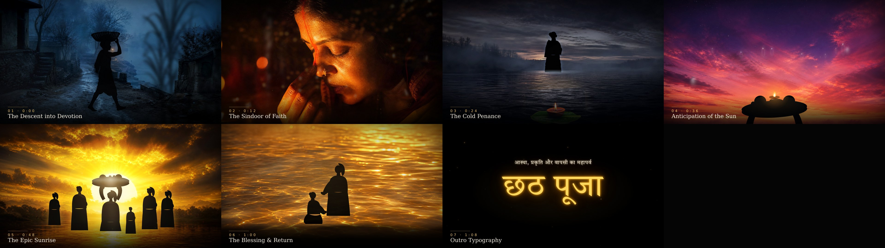

# The Golden Arghya · छठ पूजा

A 72 second cinematic short about Chhath Puja, built with [Remotion](https://remotion.dev).
Seven sequences, 2.5D parallax layers, golden hour grade, a hand-synthesised score — all
of it lives in code, so every frame is reproducible.



| | |
|---|---|
| Runtime | 72 s · 2160 frames |
| Frame rate | 30 fps |
| Canvas | 1920 × 1080 |
| Composition id | `GoldenArghya` |
| Audio | Original synthesised score + SFX (`scripts/build-audio.mjs`) |

## Watch it

```bash
npm install
npm run dev          # screening room at http://localhost:3000
```

`npm run dev` boots a small Vite "screening room" around a `@remotion/player` instance:
play/pause, a chapter strip for the seven sequences, and a timecode readout.
Append `?frame=1440` to the URL to freeze a single frame — handy for reviewing a still
without rendering anything.

```bash
npm run studio       # Remotion Studio, the timeline/scrub UI
npm run render       # out/golden-arghya.mp4
npm run still        # out/still.png
npm run audio        # regenerate the score stems into public/audio
```

## The cut

| # | Time | Sequence | Camera | Foreground |
|---|------|----------|--------|------------|
| 1 | 0:00–0:12 | The Descent into Devotion | slow lateral track right | defocused sugarcane, drifting fog |
| 2 | 0:12–0:24 | The Sindoor of Faith | dolly in, rack focus at 0:16 | incense smoke |
| 3 | 0:24–0:36 | The Cold Penance | water level, push in | diya on a leaf sweeping the lens |
| 4 | 0:36–0:48 | Anticipation of the Sun | tilt up into the sky | water drops in slow motion |
| 5 | 0:48–1:00 | The Epic Sunrise | snap dolly out 1.8 → 1.0 | gold dust, lens flare |
| 6 | 1:00–1:08 | The Blessing & Return | gentle pan left | caustic light, vignette closing in |
| 7 | 1:08–1:12 | Outro Typography | 1.0 → 1.05 on the title | rising embers |

Every scene is a `Sequence` in `src/GoldenArghya.tsx`, driven by the frame numbers in
`src/lib/timeline.ts`, so the edit is one file.

## How the 2.5D works

Three depth zones per shot, each with its own parallax multiplier. The further the layer,
the less it moves — the same way a real lens separates foreground from background.

```tsx
const bgX = track(frame, [0, 360], [2.4, -1.1]);   // village: barely creeps
const mgX = track(frame, [0, 360], [-3.2, 3.6]);   // the man: middle ground
const fgX = track(frame, [0, 360], [-18, 44]);     // sugarcane: rips past
```

Supporting techniques, all in `src/components/`:

- **Parallax plates** — camera moves are `translate`/`scale` on an oversized `object-fit: cover`
  image, so the move never reveals an edge.
- **Keyed silhouettes** — figures were generated on pure white and converted to real alpha
  (`255 - luma`) so they composite over any plate, including through the `feTurbulence`
  water distortion in `Sequence3`.
- **Atmosphere** — `Fog`, `Motes`, `IncenseSmoke`, `LensFlare`, `Diya` and `Grain` are
  procedural. Every random value is seeded (`src/lib/anim.ts`), so renders are identical
  frame to frame and machine to machine.
- **Blend modes doing the lighting** — `screen` for lamps and sun bleed, `color-dodge` for
  light wrapping around the silhouettes at sunrise, `multiply` for grade and vignette.

## Sound

There is no recording of *"Kaanch Hi Baans Ke Bahangiya"* here — that recording is
Sharda Sinha's and is not ours to ship. Instead `scripts/build-audio.mjs` renders an
original score from scratch with plain DSP: pink/brown noise, sine partials, biquad
filters and a small Schroeder reverb. It produces the river bed, cold wind and dry leaves,
the diya crackle, a D drone, a breathy bansuri line in a Bhairavi-flavoured D minor, the
dhol pattern and conch for the climax, and a single temple bell at 0:36.

Ten stems, mixed in code in `src/audio/Soundtrack.tsx` with per-frame volume curves. To
regenerate them (about 25 s):

```bash
npm run audio
```

## Assets

`public/art` holds the generated art plates — village path, ghat bokeh, twilight river,
pre-dawn sky, sunrise, golden water — plus the keyed silhouettes, the diya plate and the
film grain tile. They are illustrations rather than photographs; the film is a 2.5D
painted piece, not a documentary.

## Layout

```
golden-arghya/
├── src/
│   ├── GoldenArghya.tsx        # the edit: 7 sequences + soundtrack
│   ├── Root.tsx / index.ts     # composition registration
│   ├── lib/                    # theme, easing helpers, timeline
│   ├── components/             # atmosphere + silhouettes
│   ├── scenes/                 # Sequence1 … Sequence7
│   ├── audio/Soundtrack.tsx    # stem mixer
│   └── preview/                # screening room (Vite + @remotion/player)
├── scripts/build-audio.mjs     # the score, from noise up
├── public/art · public/audio   # plates, keyed figures, stems
└── docs/                       # storyboard + poster
```
